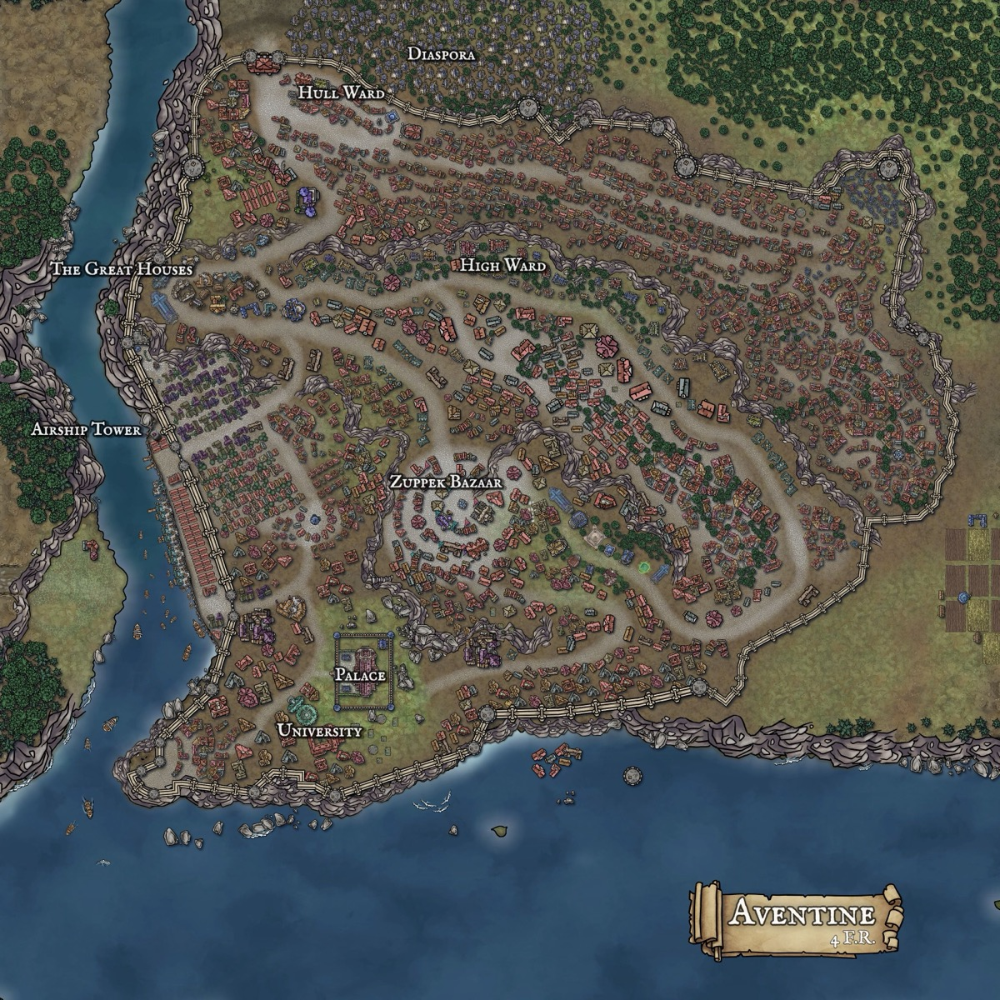

*Thumbnail, 1200px. The full-resolution original is at `/Users/i.lurie/praxia/_sourcebooks/maps/_aventine/aventine.jpeg` — see `resource`.*

## Related
**Depicts:** [Aventine](../places/aventine.md)
