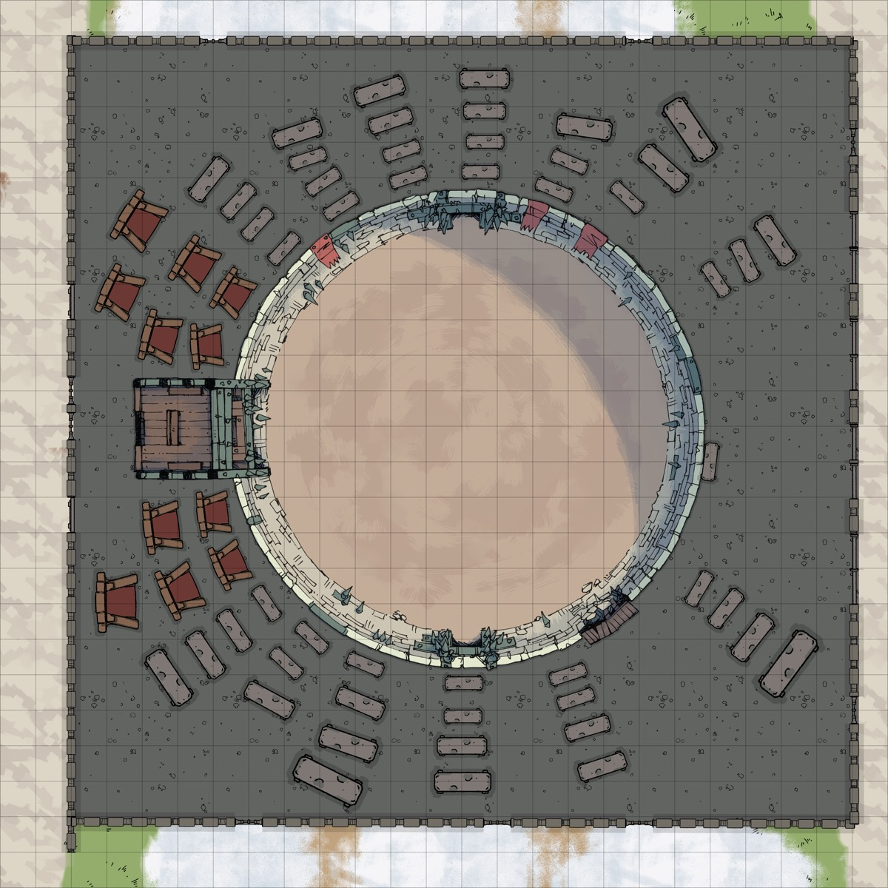

*Thumbnail, 1200px. The full-resolution original is at `/Users/i.lurie/praxia/_sourcebooks/maps/_aventine/cauldron.png` — see `resource`.*

## Related
**Depicts:** [The Cauldron](../places/the-cauldron.md)
