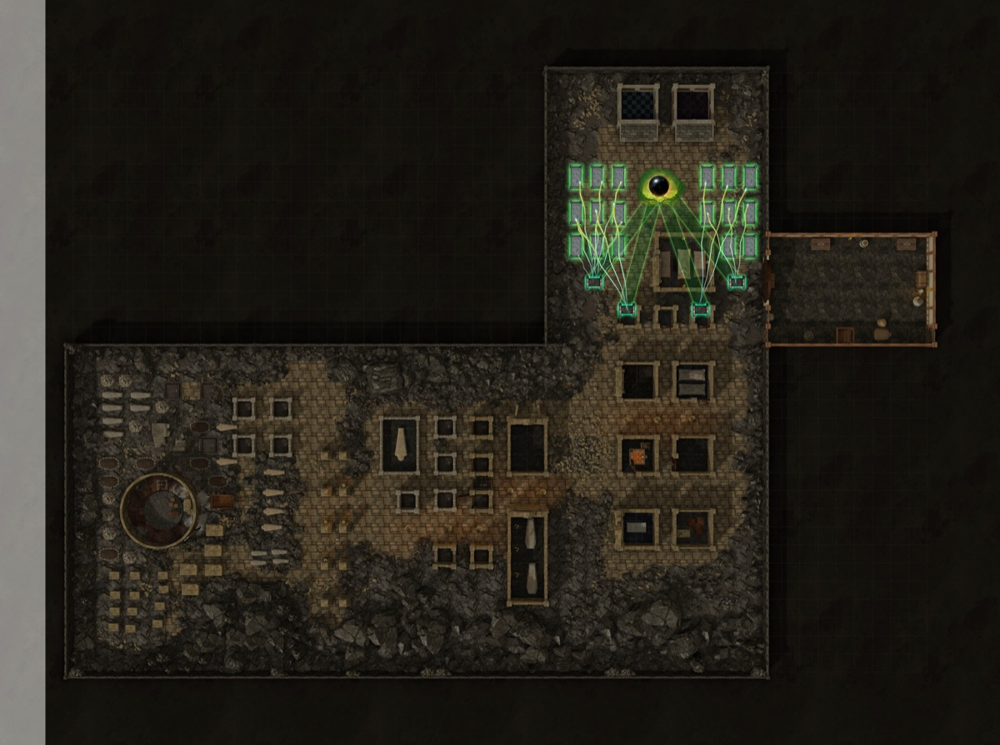

*Thumbnail, 1200px. The full-resolution original is at `/Users/i.lurie/praxia/_stories/RBG/the-flayed-god/the-crypt-of-amenopophis/themaps/crypt-3-loom%20small.png` — see `resource`.*

## Related
**Depicts:** [The Crypt Of Amenopophis](../places/the-crypt-of-amenopophis.md)
