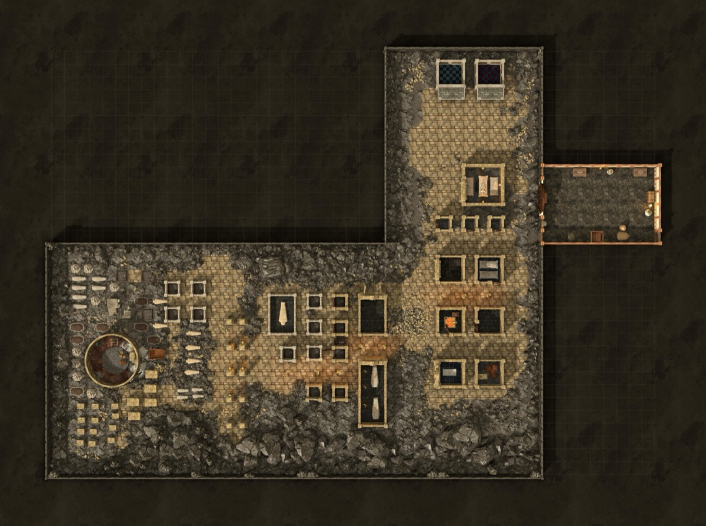

*Thumbnail, 1200px. The full-resolution original is at `/Users/i.lurie/praxia/_sourcebooks/maps/_shamharan/cryptofamenopophis-3d.jpg` — see `resource`.*

## Related
**Depicts:** [The Crypt Of Amenopophis](../places/the-crypt-of-amenopophis.md)
