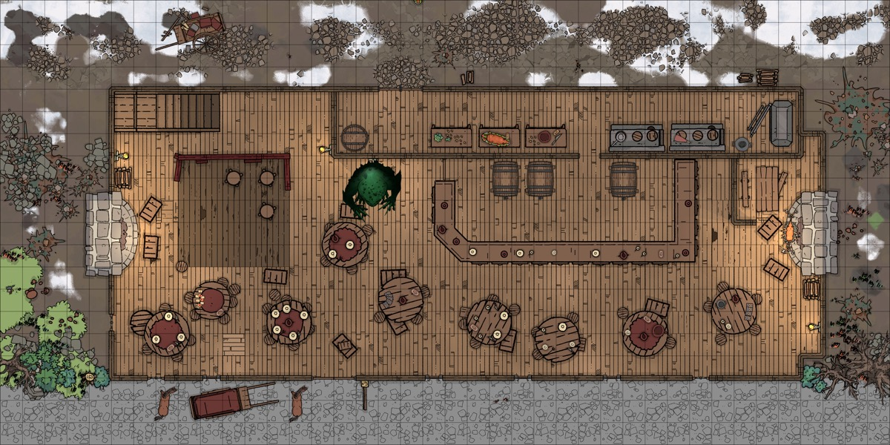

*Thumbnail, 1200px. The full-resolution original is at `/Users/i.lurie/praxia/_sourcebooks/maps/_aventine/greenslaad.png` — see `resource`.*

## Related
**Depicts:** [The Green Slaad](../places/the-green-slaad.md)
