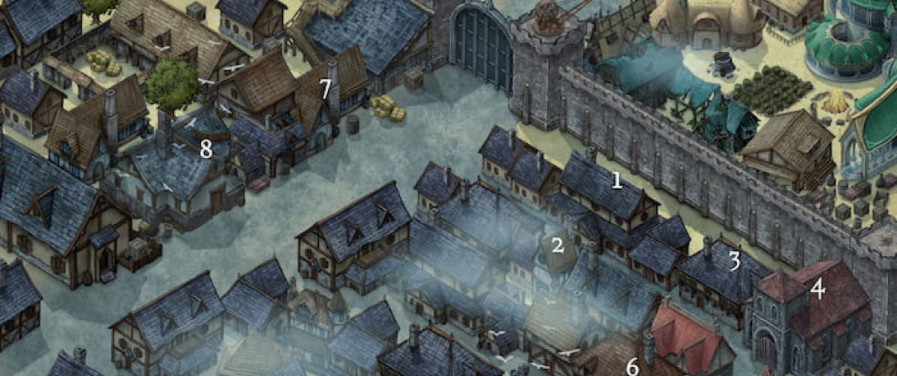

*Thumbnail, 1200px. The full-resolution original is at `/Users/i.lurie/praxia/_sourcebooks/maps/_aventine/hull-ward-featured.jpg` — see `resource`.*

## Related
**Depicts:** [Hull Ward](../places/hull-ward.md)
