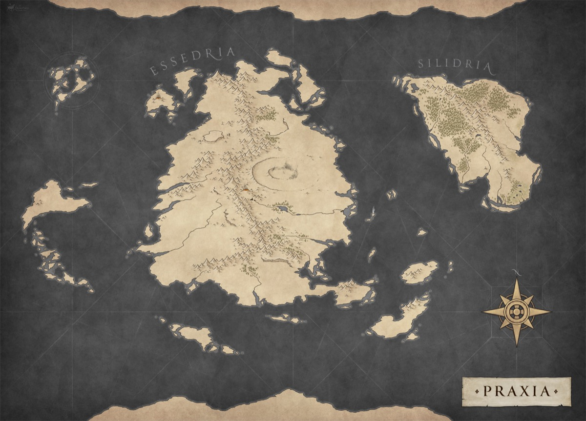

*Thumbnail, 1200px. The full-resolution original is at `/Users/i.lurie/praxia/_sourcebooks/maps/_pro-maps/praxia-editable/Map.png` — see `resource`.*

## Related
**Depicts:** [Praxia](../places/praxia.md)
