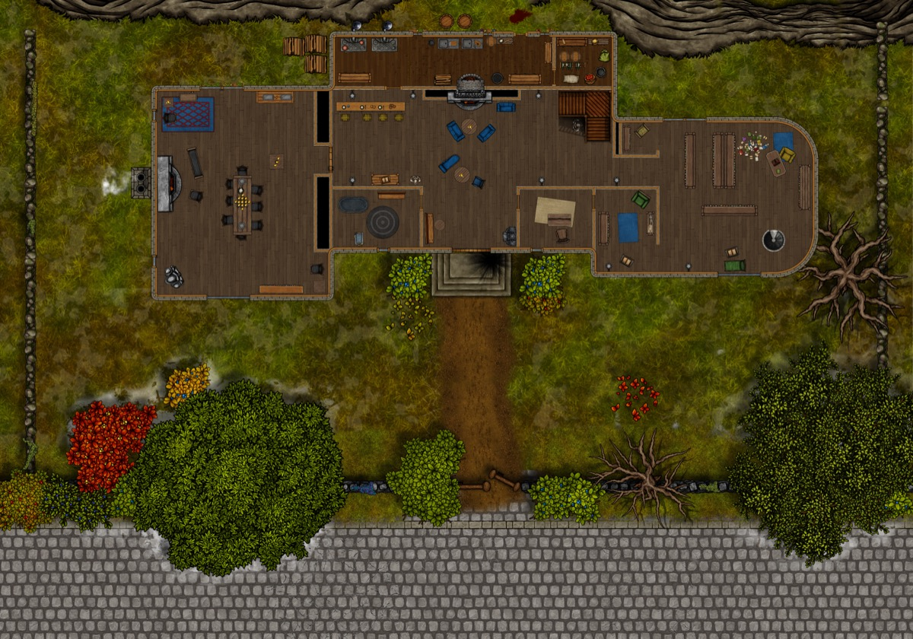

*Thumbnail, 1200px. The full-resolution original is at `/Users/i.lurie/praxia/_sourcebooks/maps/_aventine/notorious-manor-1st-floor.jpg` — see `resource`.*

## Related
**Depicts:** [The Bastion](../places/rbg-bastion.md)
