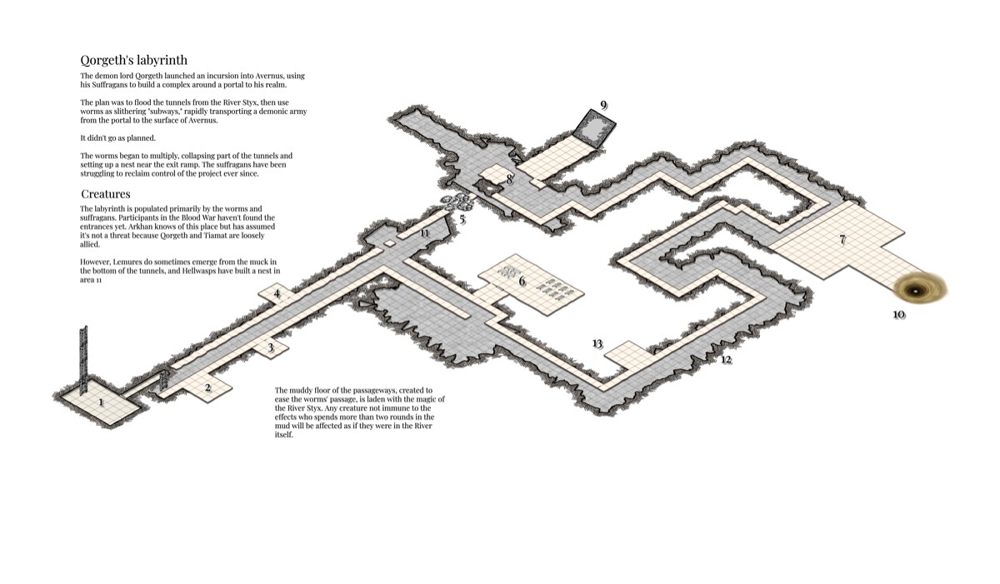

*Thumbnail, 1200px. The full-resolution original is at `/Users/i.lurie/praxia/_sourcebooks/maps/qorgethslabryinth.png` — see `resource`.*

## Related
**Depicts:** [Qorgeth's Labyrinth](../places/qorgeths-labyrinth.md)
