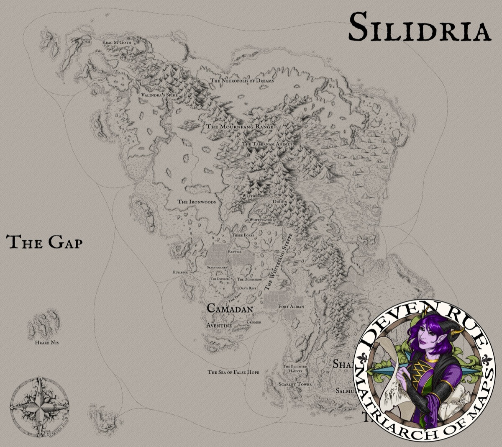

*Thumbnail, 1200px. The full-resolution original is at `/Users/i.lurie/praxia/_sourcebooks/maps/Silidria/Silidria%20Map%20by%20Deven%20Rue.jpeg` — see `resource`.*

## Related
**Depicts:** [Silidria](../places/silidria.md)
