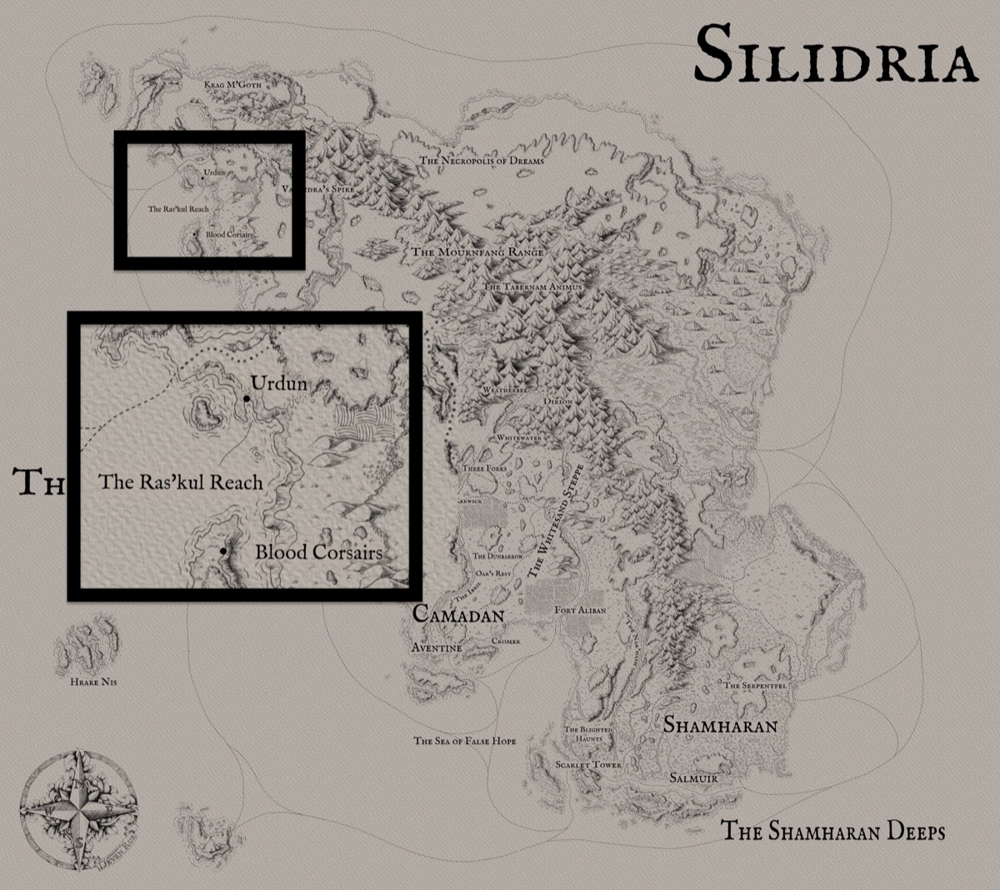

*Thumbnail, 1200px. The full-resolution original is at `/Users/i.lurie/praxia/_sourcebooks/maps/silidria-w-urdun.jpg` — see `resource`.*

## Related
**Depicts:** [Silidria](../places/silidria.md), [Urdun](../places/urdun.md)
