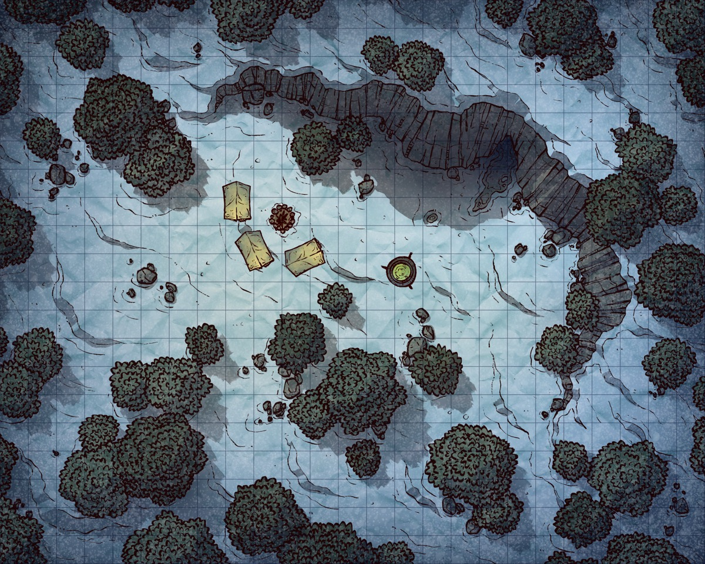

*Thumbnail, 1200px. The full-resolution original is at `/Users/i.lurie/praxia/_stories/the-leaning-leg/maps/thecamp.png` — see `resource`.*

## Related
**Depicts:** [The Mining Camp](../places/the-mining-camp.md)
