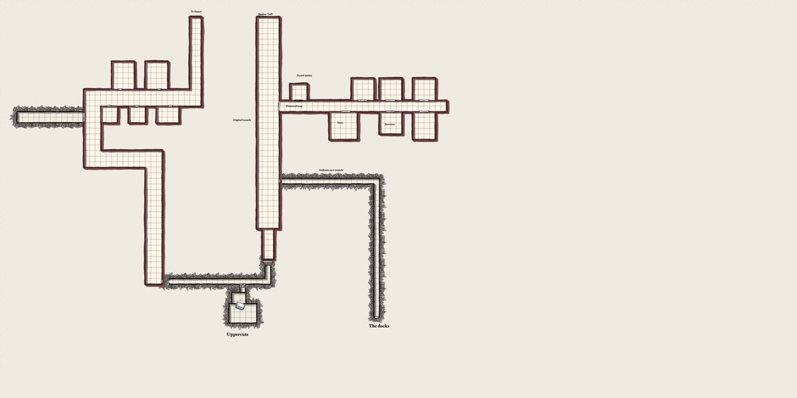

*Thumbnail, 1200px. The full-resolution original is at `/Users/i.lurie/praxia/_sourcebooks/maps/_aventine/undercity-less-details.png` — see `resource`.*

## Related
**Depicts:** [The Undercity](../places/the-undercity.md)
