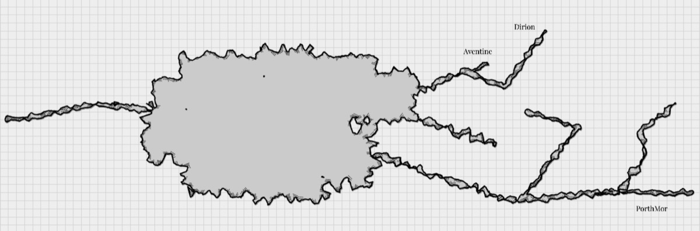

*Thumbnail, 1200px. The full-resolution original is at `/Users/i.lurie/praxia/_sourcebooks/maps/old_praxia/underdark.png` — see `resource`.*

## Related
**Depicts:** [The Underdark](../places/underdark.md)
